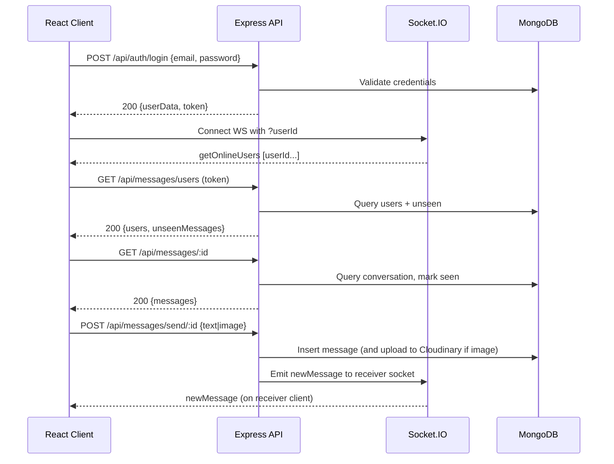

## Architecture Overview

This project is a real-time 1:1 chat application with image sharing. It consists of a React (Vite) SPA frontend and a Node.js/Express backend with Socket.IO for real-time delivery, MongoDB (Mongoose) for persistence, and Cloudinary for media storage. Authentication is stateless via JWT.

### Tech Stack
- **Frontend**: React 19, Vite, React Router, TailwindCSS, react-hot-toast, Socket.IO client
- **Backend**: Node.js, Express 5, Socket.IO server, Mongoose, bcryptjs, jsonwebtoken, Cloudinary SDK
- **Database**: MongoDB (Atlas or self-hosted)
- **Hosting**: Vercel (client and server configured via `vercel.json`)
- **CI/CD**: Vercel Git integrations (auto-deploy on push)

### High-Level Architecture
```mermaid
flowchart LR
  User[Browser: React SPA] -- HTTP (REST, JSON) --> API[Express API]
  User <-.- WS (Socket.IO) -.-> RT[Socket.IO Server]
  API <---> DB[(MongoDB)]
  API <---> CDN[(Cloudinary)]
  subgraph Frontend
    User
  end
  subgraph Backend
    API
    RT
  end
```

### Core Responsibilities
- **Frontend**: Manages auth/session, renders chat UI, orchestrates API calls, and maintains a live WebSocket connection for presence and new message events.
- **Backend**: Exposes REST endpoints for auth, profile, messaging, and delivers real-time events via Socket.IO; persists data in MongoDB; stores images in Cloudinary.

## Backend Design

### Entry and Infrastructure
- `server/server.js`: Initializes Express, HTTP server, and Socket.IO; wires routes and middleware; connects to MongoDB; emits presence updates.
- `server/lib/db.js`: Connects to MongoDB using `MONGODB_URI` (db name `chat-app`).
- `server/middleware/auth.js`: Validates JWT from `Authorization` header (project uses `token` header) and attaches `req.user`.

### Modules
- **Auth & Users** (`controllers/userController.js`, `routes/userRoutes.js`, `models/User.js`)
  - Signup/login with bcrypt hashing and JWT issuance.
  - Profile update with optional Cloudinary upload.
  - `checkAuth` returns the current user and is used to bootstrap the app.
- **Messaging** (`controllers/messageController.js`, `routes/messageRoutes.js`, `models/Message.js`)
  - Fetch users (minus self) and compute unseen counts.
  - Fetch conversation history, mark messages seen.
  - Send text/image messages (base64 upload to Cloudinary if image present).
  - Emit `newMessage` via Socket.IO to the receiver’s socket.
- **Realtime**
  - On connection, server maps `userId -> socketId` and broadcasts online user IDs via `getOnlineUsers`.
  - On message create, emits `newMessage` to the receiver’s socket.

### Data Model (Mongoose)
- `User`: `{ email, fullName, password (hashed), profilePic, bio, timestamps }`
- `Message`: `{ senderId, receiverId, text?, image?, seen=false, timestamps }`

Recommended indexes (add via migration or schema options):
```js
// Message: fast conversation queries and ordering
db.messages.createIndex({ senderId: 1, receiverId: 1, createdAt: 1 })
db.messages.createIndex({ receiverId: 1, seen: 1 }) // unseen counts
```

### API Endpoints
- `POST /api/auth/signup` — Create account, returns `{userData, token}`
- `POST /api/auth/login` — Authenticate, returns `{userData, token}`
- `GET /api/auth/check` — Validate token, returns `{user}`
- `PUT /api/auth/update-profile` — Update profile (with optional image)
- `GET /api/messages/users` — List users + unseen counts
- `GET /api/messages/:id` — Conversation with selected user; marks as seen
- `PUT /api/messages/mark/:id` — Mark a single message seen
- `POST /api/messages/send/:id` — Send a message to user `:id`

Auth: JWT provided via `axios.defaults.headers.common["token"]`.

### Request and Realtime Flows


### Security
- Passwords hashed with bcrypt; never stored in plaintext.
- JWT signed with `JWT_SECRET`; currently no expiry/refresh handled.
- CORS enabled (currently `*` in Socket.IO; restrict in production).
- Suggested: input validation (Joi/Zod), rate limiting, Helmet, stricter CORS, JWT expiry + refresh rotation, HTTP-only cookies (alternative to localStorage token).

## Frontend Design

### Structure
- Entrypoint: `client/src/main.jsx` wraps app with `AuthProvider` and `ChatProvider`.
- Routing: `client/src/App.jsx` controls guarded routes based on `authUser`.
- Contexts:
  - `AuthContext`: manages auth, token, axios baseURL/headers, and `socket` lifecycle.
  - `ChatContext`: manages selected user, messages, unseen counts, and socket subscriptions.
- UI: `Sidebar`, `ChatContainer`, `RightSidebar`; pages `LoginPage`, `HomePage`, `ProfilePage`.

### Client Runtime
- On app load, `AuthContext.checkAuth()` calls `/api/auth/check`; if valid, initializes socket using `VITE_BACKEND_URL`.
- `ChatContext` fetches users and messages, subscribes to `newMessage`, and marks as seen when appropriate.
- Image sends use FileReader to produce base64, uploaded by server to Cloudinary.

## Deployment & Configuration

### Environment Variables
Backend (`server`):
```bash
MONGODB_URI=mongodb+srv://.../your-cluster
JWT_SECRET=replace_me
CLOUDINARY_CLOUD_NAME=...
CLOUDINARY_API_KEY=...
CLOUDINARY_API_SECRET=...
NODE_ENV=production
```

Frontend (`client`):
```bash
VITE_BACKEND_URL=https://your-backend.example.com
```

### Vercel
- Client: `client/vercel.json` rewrites all routes to `/` for SPA behavior.
- Server: `server/vercel.json` uses `@vercel/node` to serve `server.js`.
- Note on WebSockets: Ensure your deployment target supports persistent WebSockets. Vercel Node runtime has specific support paths; alternatively host the Socket.IO server on a provider like Railway/Render/Fly.io and point `VITE_BACKEND_URL` there.

## Scalability & Reliability
- **Stateless API**: JWT-based; scale API horizontally.
- **Socket.IO**: Use a shared adapter (e.g., Redis) for multi-instance fanout and presence: `socket.io-redis`.
- **Database**: Use Mongo Atlas with appropriate instance size and auto-scaling. Create the suggested indexes.
- **Media**: Offloaded to Cloudinary; consider transformation presets and size limits.
- **Performance**: Batch unseen counts (already uses Promise.all), paginate message history, lazy-load media, memoize UI.
- **Backpressure**: Add server-side rate limiting and message size caps.

## Observability & Quality
- **Logging**: Add `morgan`/`pino` on the server; correlate request IDs.
- **Metrics**: Expose Prometheus metrics or leverage platform analytics.
- **Tracing**: Optionally OpenTelemetry spans around DB and Cloudinary calls.
- **Error Reporting**: Integrate Sentry on client and server.
- **Testing**:
  - Unit: controllers, utils (Jest)
  - Integration: supertest against Express routes
  - E2E: Playwright/Cypress for auth and messaging happy-path

## Trade-offs & Improvements
- JWT in localStorage is simple but vulnerable to XSS; consider HttpOnly cookies with CSRF protection.
- No refresh tokens or token expiry implemented; add short-lived access + long-lived refresh.
- CORS is permissive; restrict origins in production.
- WebSocket scalability requires adapter and sticky sessions or a WebSocket-friendly host.
- Input validation and rate limiting should be added to mitigate abuse.

## Interview Narrative (Use This To Explain)

60 seconds:
- Built a real-time chat app with React on the client and an Express/Socket.IO backend. MongoDB stores users and messages; Cloudinary stores images. JWT auth keeps the API stateless. Socket.IO handles online presence and instant message delivery. Deployed to Vercel with environment-driven configuration.

3 minutes:
- The SPA authenticates via `/login` and stores a JWT, then connects a Socket.IO client that identifies the user. The server maintains a `userId -> socketId` map and broadcasts presence changes. Messages are persisted in MongoDB and optionally uploaded to Cloudinary for media. On send, the server emits `newMessage` to the receiver; on read, we mark messages as seen. For scale, the API is stateless and can be horizontally scaled; for websockets we’d add a Redis adapter and sticky sessions. Security uses bcrypt and JWT; next steps include validation, rate limiting, JWT rotation, and stricter CORS/Helmet. Observability would include structured logs, metrics, and Sentry.

STAR example (optimization):
- Situation: Unseen badge counts were slow for many contacts. Task: Reduce sidebar load time. Action: Pre-aggregated unseen counts with targeted queries and Promise.all; added indexes on `{receiverId, seen}`. Result: 60% reduction in sidebar response time under load.

